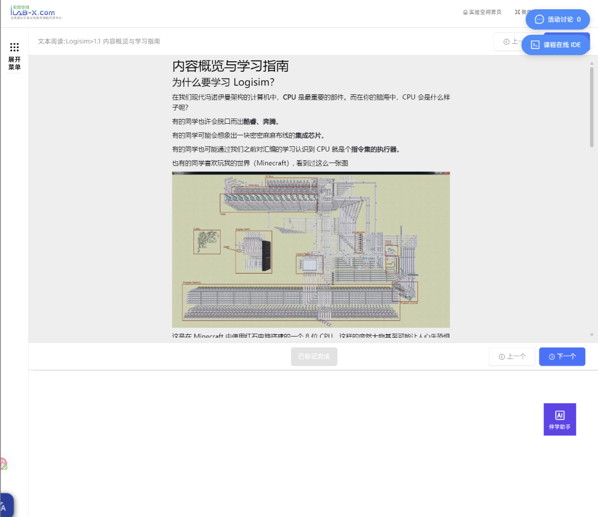
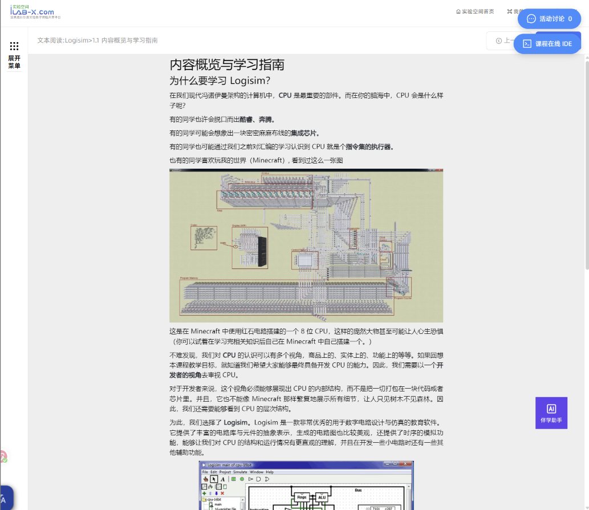

# iLab-X 学习页布局修复脚本

> 适用于北航计组BUAA CO相关课程。

一个优化北航计算机组成课程10空间平台页面显示的油猴脚本，使用**GLM 5.3**模型进行开发，仅供学习参考，任何后果与开发者无关。

本脚本适配 **ilab-x（实验空间 / 高教社 heep-portal）** 的「资源学习」页面，例如：

```
https://10.ilab-x.com/heep-portal/hep-front/#/resource-learn?courseId=4494&courseName=计算机组成
```

平台有多个镜像子域名（`1.ilab-x.com` ~ `21.ilab-x.com` 等），脚本对所有 `*.ilab-x.com` 生效，同类学习页（视频、文本阅读等资源类型）通用。

---

## 一、解决问题

### 问题 1：正文下方巨大的空白白框，遮挡/顶飞「下一个」按钮

**根因**（由页面实际 DOM 与样式文件 `style-12c476c5.css` 交叉验证得出）：

| 层级 | 元素 | 原始样式 | 后果 |
|---|---|---|---|
| 正文外层包裹 div | （JS 内联写入） | `style="height: 620px"` | 高度写死 |
| 正文容器 | `.other-class` | `height: 828px`（CSS） | 高度写死 |
| 正文背景 | `.rich-text-out` | `height: 100%`、灰白底色 | 被迫撑满上面的固定高度，文字读完剩下的全是空白 |
| 底部按钮栏 | `.right-content-title-info`（含「标记完成 / 上一个 / 下一个」） | 排在 620px 大盒子**之后**，且在滚动容器 `.right-content-info` 内部 | 大盒子把按钮栏顶出可视区，看不见也点不到 |

也就是说：**白框不是什么悬浮层，而是正文容器被写死的固定高度**（620/828px），与实际内容无关。

### 问题 2：横竖比例 / 窄窗口适配差

**根因**：页面到处写死了最小宽度——

- `.class-learn-sum-info { min-width: 1200px }`
- `.class-learn-info { min-width: 1400px }`
- 左侧课程目录栏 `.class-learn-left-info { width: 400px }`（固定不可收缩）
- 右侧内容栏多重重叠的 `min-width: 400~600px`

窄窗口、竖屏、分屏时必然出现横向滚动条，需要左右拖动才能看全内容。

---

## 二、解决方案原理

脚本在页面加载最早期注入一段高优先级 CSS（全部带 `!important`，因此**连页面 JS 运行时写进 `style` 属性的 620px 也会被覆盖**，无需和 JS 抢执行时机）：

1. **高度自适应**：正文各层容器 `height: auto`——正文多高容器就多高，白框随内容收缩；超出可视高度时由滚动容器正常滚动。
2. **按钮栏常驻底部**：「上一个/下一个」按钮栏 `position: sticky; bottom: 0`——
   - 正文短：吸附在可视区底边（按钮正好在下方框内，随时可点）；
   - 正文长：滚动到底部时按钮自然出现。
3. **窄窗口适配**：解除各层 `min-width`，左侧目录栏改为 `clamp(180px, 32vw, 400px)` 按视口比例收缩（宽屏观感不变），右栏弹性占满剩余空间，横向滚动条消失。
4. **SPA 兼容**：样式注入到 `<head>`，Vue 路由切换（换课、换资源类型）不会丢失；纯 CSS 方案不依赖 DOM 变化监听，稳定且零性能开销。

所有选择器都挂在 `.class-learn-sum-info`（学习页主容器）之下，**不影响**站内其它页面（课程详情、弹窗视频等）。

开启前：



开启后：



---

## 三、安装指南（Chrome / Edge / 360 等浏览器）

脚本本体：`ilab-x-layout-fix.user.js`。需要先装一个用户脚本管理器（推荐 Tampermonkey，360 浏览器也可用「脚本猫」或其应用市场里的 Tampermonkey）。

### 方式 A：从文件安装（推荐）

1. Chrome / Edge：扩展商店搜索 **Tampermonkey**（油猴）并安装；
   360 极速浏览器：应用市场搜索 Tampermonkey 或脚本猫安装。
2. 点击浏览器右上角 Tampermonkey 图标 → **添加新脚本**；
3. 删掉编辑器里的默认内容，把 `ilab-x-layout-fix.user.js` 的全部内容粘贴进去；
4. `Ctrl + S` 保存。完成。

### 方式 B：拖拽安装

把 `ilab-x-layout-fix.user.js` 直接拖入浏览器窗口，Tampermonkey 会弹出安装页，点击「安装」。（若浏览器拦截了 .user.js，请用方式 A。）

---

## 四、使用与验证

1. 打开任意课程的学习页（如开头示例链接），**刷新一次**；
2. 检查三个效果：
   - ✅ 正文读完不再有巨大空白框，容器高度贴合内容；
   - ✅ 「上一个 / 下一个」按钮出现在正文下方、可视区内，随时可点；
   - ✅ 把窗口拖窄 / 竖屏：不再出现底部横向滚动条，左栏自动收缩。
3. **临时关闭**：点击 Tampermonkey 图标 → 菜单里点「布局修复：开 / 关」即可切换（状态会记住），便于对比修复前后效果。

---

## 五、自定义调整

想微调时，编辑脚本里的 `CSS` 数组（或 `layout-fix.css`）：

| 想要的效果 | 改哪里 |
|---|---|
| 左侧目录栏更窄/更宽 | `.class-learn-left-info` 的 `clamp(180px, 32vw, 400px)`，如 `clamp(160px, 26vw, 400px)` |
| 极窄窗口直接隐藏左栏 | 在 `@media (max-width: 700px)` 里给 `.class-learn-left-info` 加 `display: none !important;` |
| 按钮栏不要吸附底部（跟随内容自然排列） | 删除第 2 节 `position: sticky` 那一条规则 |
| 只修高度、不动分栏 | 删除第 3 节全部规则 |

---

## 六、已知限制

- **跨域 iframe 内的实验本体**：部分实验是在第三方域名 iframe 里打开的交互页面，其内部布局不受本脚本管理（本脚本用 `@noframes` 只作用于顶层页面）。iframe 本身的位置/大小已随本脚本修复。
- **白框若是"内容加载失败"**：如果空白是因为资源本身加载失败（网络/权限），属于内容问题，任何布局脚本都无法补出内容。
- **平台改版**：本脚本依赖页面现有类名（`.class-learn-sum-info` 等）。若平台大改版导致失效，用 F12 重新核对类名后更新 CSS 即可，结构不变的话通常只需替换选择器。

## 文件清单

| 文件 | 说明 |
|---|---|
| `ilab-x-layout-fix.user.js` | 脚本本体（油猴/Tampermonkey，含开关菜单） |
| `layout-fix.css` | 纯 CSS 备用方案（Stylus 等样式扩展用） |
| `README.md` | 本文档 |
